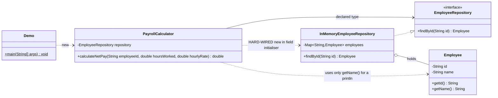
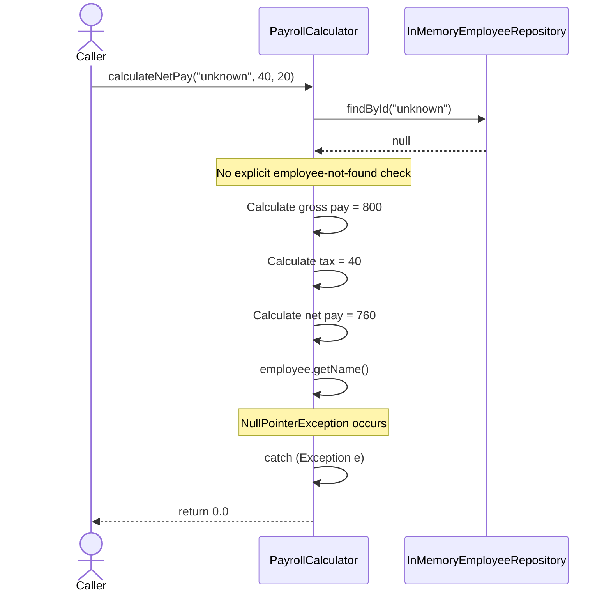
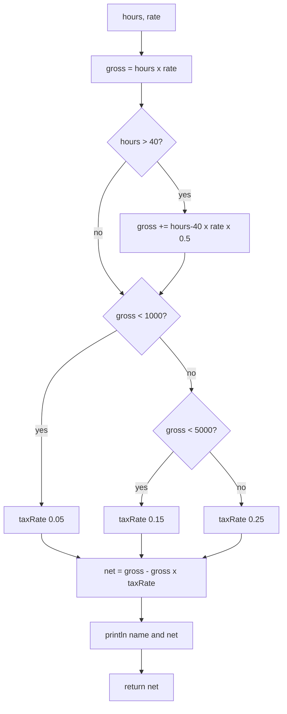

# ANALYSIS: Rosewood Payroll (pre-refactor)

---

## 1. Scope and method

**Inherited code (6 production files, 1 test file):**

| File | Role |
|---|---|
| `PayrollCalculator` | Net-pay calculation (holds almost all the logic) |
| `EmployeeRepository` | Interface for employee lookup |
| `InMemoryEmployeeRepository` | HashMap-backed implementation, returns `null` when not found |
| `Employee` | Simple model (id, name) |
| `Demo` | `main` that exercises the calculator |
| `PayrollCalculatorTest` | 3 AI-generated tests |

**Method:**
1. Ran `mvn verify` (tests and JaCoCo) and the PIT mutation run. The Demo run is still to do.
2. Used PIT's survivors and no-coverage mutants as evidence of which behaviour the tests do not check.
3. Planted the constant-change bugs by hand (section 2.3), still to confirm.
4. Read every file against the coding standard and the SOLID principles.

---

## 2. Baseline evidence

Run on 13 Nov 2026: `mvn verify` (tests + JaCoCo), then `mvn test-compile org.pitest:pitest-maven:mutationCoverage`.

| Check | Result |
|---|---|
| `mvn verify` | BUILD SUCCESS. 3 tests run, 0 failures, 0 errors, 0 skipped |
| Console output during tests | `Net pay for Efua Sarpong: GHS 831.25` and `GHS 760.0`. Business data (a name and a pay figure) is printed by the calculator on every call. |
| Hand check of the two real calls | e1, 40h @ 20: gross 800, 5% tax, net **760.0** (matches). e1, 35h @ 25: gross 875, 5% tax, net **831.25** (matches). The LOW band is computed correctly. |
| Both real tests use | the same employee (`e1`), LOW band only, no overtime |
| Demo output for unknown employee | ‹not run yet. Run `mvn compile exec:java -Dexec.mainClass=com.rosewood.payroll.Demo`› |
| JaCoCo line / branch coverage | ‹read from `target/site/jacoco/index.html`›. The report was generated and analysed 4 classes. |
| PIT line coverage (mutated classes) | **21 / 34 (62%)** |
| PIT mutations generated | **21** |
| PIT killed | **3 (14%)** |
| PIT survived | **8** |
| PIT no coverage | **10** |
| PIT test strength | **27%** (3 killed out of the 11 mutants the tests actually reached) |

**Headline:** 62% of lines are executed and 100% of tests pass, yet only 14% of the injected bugs are caught. Line coverage and a green build say almost nothing about whether the tests would catch a wrong payslip.

### 2.1 PIT results by mutator

| Mutator | Generated | Killed | Survived | No coverage |
|---|---|---|---|---|
| Conditionals boundary (`>` to `>=`, `<` to `<=`) | 3 | 0 | 2 | 1 |
| Negate conditionals | 3 | 0 | 2 | 1 |
| Math (`+ - * /` swapped) | 7 | 1 | 2 | 4 |
| Void method call (statement removed) | 4 | 0 | 1 | 3 |
| Empty object returns | 2 | 0 | 1 | 1 |
| Primitive returns | 1 | 1 | 0 | 0 |
| Null returns | 1 | 1 | 0 | 0 |
| **Total** | **21** | **3** | **8** | **10** |

### 2.2 Reading the PIT results (by inspection; confirm in `target/pit-reports/index.html`)

| Result | Most likely explanation |
|---|---|
| 4 Math mutants: no coverage | The four operators in the overtime line never execute, because no test uses more than 40 hours. |
| 1 conditional boundary and 1 negate: no coverage | `gross < 5000` is never reached, since both real tests stay in the LOW band. MEDIUM and HIGH are untested. |
| Boundary mutants on `hoursWorked > 40` and `gross < 1000` survive | Test inputs are 35h and 40h, with gross 800 and 875. Nothing sits on or near a boundary, so `>=` and `<=` go unnoticed. |
| Math survivors: `hours * rate` and the `-` in `gross - tax` | `net > 0` still holds when gross becomes tiny or tax is added instead of subtracted. |
| The one Math mutant killed | Most likely `gross * taxRate` becoming `/`, which drives net negative and fails `net > 0`. It is caught only by accident. |
| Void method call survived (1) and 3 not covered | Removing the calculator's `println` changes nothing any test checks. The other three are `Demo`'s prints, which no test runs. |
| Empty-object returns: 1 survived, 1 no coverage | `getName()` returning `""` goes unnoticed (it is only printed). `getId()` is never called. |
| Null-return on `findById` killed | Only because a null employee throws an NPE, the catch returns `0`, and `net > 0` then fails. A swallowed exception is the only thing "catching" this mutant. |
| Nothing is reported for `return 0` in the catch | The swallowed failure is invisible to mutation testing, because the mutated value is the same as the original. It needs a deliberate test. |

### 2.3 Planted-bug check: PIT prediction and manual confirmation

PIT already covers boundary changes and removed calls. Constant changes (`0.15` to `0.16`) are not in PIT's default mutators, so those are checked by hand. For each row: change one thing, run `mvn test`, then `git checkout src/`.

| Change | PIT / reasoning predicts | Confirmed manually? |
|---|---|---|
| `0.15` to `0.16` (MEDIUM rate) | Tests stay green: MEDIUM never reached | ‹yes / no› |
| `hoursWorked > 40` to `>= 40` | Tests stay green: conditional boundary mutant survived | ‹yes / no› |
| `0.5` to `0.4` (overtime premium) | Tests stay green: overtime block never executes | ‹yes / no› |
| `gross < 1000` to `gross <= 1000` | Tests stay green: conditional boundary mutant survived | ‹yes / no› |
| Delete the overtime block entirely | Tests stay green: no coverage | ‹yes / no› |

### 2.4 Environment note (not a finding about the code)

`mvn verify` printed many `IllegalClassFormatException ... Unsupported class file major version 71 / 68` traces from JaCoCo. These come from JDK-internal and ByteBuddy classes, not from project classes, and the build still succeeded. The cause is a JDK newer than JaCoCo 0.8.12 supports; the starter README asks for JDK 21. Mockito also warns that it is self-attaching its agent. Both are noise for now.

---

## 3. Structure of the inherited code (UML)

### 3.1 Class diagram (as-is)

**What the diagram shows:**
- The `EmployeeRepository` interface exists, but the dashed "HARD-WIRED" arrow bypasses it. The abstraction is never a real seam.
- `PayrollCalculator` is the only class with logic, and it depends on everything else. There is no tax, overtime, validation or money abstraction at all.
- `Employee` is used only to print a name, so the lookup contributes nothing to the number returned.

### 3.2 Sequence diagram: unknown employee (the silent failure)

**What the diagram shows:** the "not found" case is never checked. It is only detected because the `println` happens to dereference `null`. The correct net pay is calculated and then thrown away. The caller receives `0.0` with no signal that anything went wrong.

### 3.3 Decision flow of the tax calculation (as-is)

**What the diagram shows:** a hard-coded `if/else` ladder. A new band means editing this method, which is an Open/Closed violation.

---

## 4. Code smells and SOLID violations (ranked)

Ranking criterion: **consequence for a real payslip**, then how hard the problem is to notice.

| Rank | Finding | Where | Evidence | Why it matters for payroll | Standard |
|---|---|---|---|---|---|
| **1** | **Swallowed failure.** `catch (Exception e) { return 0; }` | `PayrollCalculator`, catch block | Demo prints `0.0` for an unknown employee | Every error (missing employee, bad input, a bug) becomes `0`, which is also a legitimate answer for 0 hours. Callers cannot distinguish failure from a real result. | § ___ |
| **2** | **No deliberate "not found" handling.** The repository returns `null`; the code never checks it. | `InMemoryEmployeeRepository.findById`; `println` in the calculator | Sequence diagram 3.2 | The missing-employee path only works by accident (an NPE). Remove the print and an unknown employee gets paid. | § ___ |
| **3** | **Money as `double`, no rounding rule** | `PayrollCalculator` throughout | `gross - gross * taxRate` | Binary floating point cannot represent most decimal amounts exactly, and there is no defined rounding to pesewas. Payslips can drift by a fraction of a pesewa. | § ___ |
| **4** | **No input validation** | `calculateNetPay` | -5h @ 20 gives gross -100, tax 5%, **net -95**. `NaN` hours skip every comparison and land in the HIGH band, returning `NaN`. | Negative hours, negative rates, `NaN` and `Infinity` produce nonsense with no error. | § ___ |
| **5** | **Tax bands as an `if/else` chain (Open/Closed)** | `PayrollCalculator` | Diagram 3.3 | The coming tax band cannot be added without editing existing logic, which risks breaking the three bands that already work. | § ___ |
| **6** | **Hard-wired dependency (Dependency Inversion)** | `new InMemoryEmployeeRepository()` in the field initialiser | Diagram 3.1 | Cannot substitute a stub or mock, so a failing lookup can't be tested. This is the root cause of test 2 being a mock of the class under test. | § ___ |
| **7** | **God method (Single Responsibility).** One method does lookup, overtime, gross, band selection, tax, net, printing and error policy. | `calculateNetPay` | ~8 reasons to change | Any rule change touches the same method, and nothing can be tested in isolation. | § ___ |
| **8** | **I/O in business logic.** `System.out.println` with the employee's name, pay and a hard-coded `GHS`. | `calculateNetPay` | | Side effect inside a calculation, personal data written to stdout, no logging control, currency hard-coded. | § ___ |
| **9** | **Magic numbers.** `40`, `0.5`, `1000`, `5000`, `0.05`, `0.15`, `0.25` | `calculateNetPay` | | Business rules are invisible and unnamed. The comments `// LOW` etc. are standing in for names. | § ___ |
| **10** | **Pointless employee lookup.** The `Employee` is used only for the print, while the rate comes from the caller. | `calculateNetPay` | | Either the lookup should be a real validation (employee must exist), or it should be removed. This needs a design decision (see Decisions). | § ___ |
| **11** | **Primitive obsession / unclear API.** Three loose primitives (`String`, `double`, `double`) in a fixed order. | Method signature | | Easy to swap `hours` and `rate` without the compiler noticing. No types for money or hours. | § ___ |
| **12** | **Repository returns `null` instead of `Optional`/exception.** | `EmployeeRepository` contract | | The contract does not tell callers that absence is possible. | § ___ |
| **13** | **`Demo` coupled to the concrete constructor** | `Demo` | | Will break when dependencies are injected, so it must be updated as part of the refactor. | § ___ |

### 4.1 SOLID scorecard

| Principle | Violated? | Where |
|---|---|---|
| **S**ingle Responsibility | Yes | Findings 7, 8 |
| **O**pen/Closed | Yes | Finding 5 |
| **L**iskov Substitution | Not evidenced | Only one implementation exists to compare |
| **I**nterface Segregation | Not evidenced | `EmployeeRepository` is small and focused |
| **D**ependency Inversion | Yes | Finding 6 |

---

## 5. Open business question: cliff-edge tax

The tax rate applies to the **entire** gross, not just the slice above each threshold.

| Gross | Rate | Tax | Net |
|---|---|---|---|
| 999.99 | 5% | 50.00 | **949.99** |
| 1000.00 | 15% | 150.00 | **850.00** |
| 4999.99 | 15% | 750.00 | **4249.99** |
| 5000.00 | 25% | 1250.00 | **3750.00** |

Earning GHS 0.01 more **reduces** take-home pay by about GHS 100 at the first threshold and about GHS 500 at the second. Real tax systems apply marginal bands.

**Status:** unresolved. I cannot tell from the code whether this is the business rule or an AI-introduced bug. I will **not** silently change it during the refactor. The decision and its reasoning go in the Decisions section. Either way, both boundaries need explicit boundary tests.

---

## 6. AI-generated tests that prove nothing (ranked separately)

| Rank | Test | What it really asserts | Why it cannot catch a bug | Verdict |
|---|---|---|---|---|
| **1** | `calculatesOvertimePay` | A `mock(PayrollCalculator.class)` returns the value it was told to return (1402.5) | **The real code never runs.** It tests Mockito. It would pass if the whole calculator were deleted. The name falsely claims overtime coverage. | Hollow: worst |
| **2** | `returnsPayForAnEmployee` | `assertNotNull(net)` where `net` is a primitive `double` | A primitive is autoboxed, so it can never be `null`. **The assertion cannot fail.** | Hollow |
| **3** | `calculatesNetPay` | `net > 0` for e1, 40h @ 20 | Runs the real code, but accepts any positive number. Wrong rate, wrong tax, wrong gross all pass. Correct value is 760. | Weak |

**Rank reasoning:** test 1 is the most dangerous because it looks like overtime coverage while exercising none of the code, and it inflates confidence for the most error-prone rule. Test 2 is a logical impossibility. Test 3 at least touches real code and would fail if the lookup broke.

**What was good and is kept:** the figure `1402.5` in test 1 is correct (50h @ 30 gives gross 1650, 15% tax). The expectation is reused, but in a real test against the real code.

### 6.1 Coverage map: what the 3 tests actually exercise

| Behaviour | Exercised by any test? |
|---|---|
| Employee found | Yes (tests 1, 3) |
| Employee not found | No |
| Overtime branch (`hours > 40`) | No |
| Exactly 40 hours | Yes, but no overtime assertion |
| LOW band (< 1000) | Yes, but value unchecked |
| MEDIUM band (1000 to 4999.99) | No |
| HIGH band (>= 5000) | No |
| Invalid hours or rate | No |
| Catch block | No |
| Exact net value | **No** |

---

## 7. Missing tests (to be written during the rebuild)

- Unknown employee raises a specific exception (not `0`).
- Zero hours, negative hours, `NaN`, `Infinity` rejected.
- Exactly 40 h (no overtime), 40.5 h, 41 h (premium on the extra hours only).
- Band boundaries: 999.99, 1000.00, 4999.99, 5000.00.
- Exact expected values computed by hand (not copied from code output).
- Rounding behaviour to two decimal places.
- Repository collaborator failing (using a stub or mock through the injected seam).

---

## 8. Most serious problem 

The most serious problem is the **swallowed failure combined with hollow tests**. Individually they are bad, but together they make every other defect invisible: the code converts any error into a plausible-looking `0`, and the test suite cannot detect either the wrong number or the wrong behaviour. Money as `double` and the cliff-edge tax are real risks, but they would be caught by a suite that asserted exact values. The swallowed exception and the green-but-empty tests are what stop anyone from finding them. The measured evidence fits this: the build is green with 62% line coverage, yet PIT kills only 3 of 21 mutants (14%), and the one test that kills anything does so by accident through `net > 0`.

---

## 9. Decisions *(added after the refactor)*

