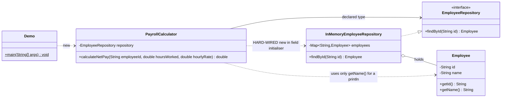
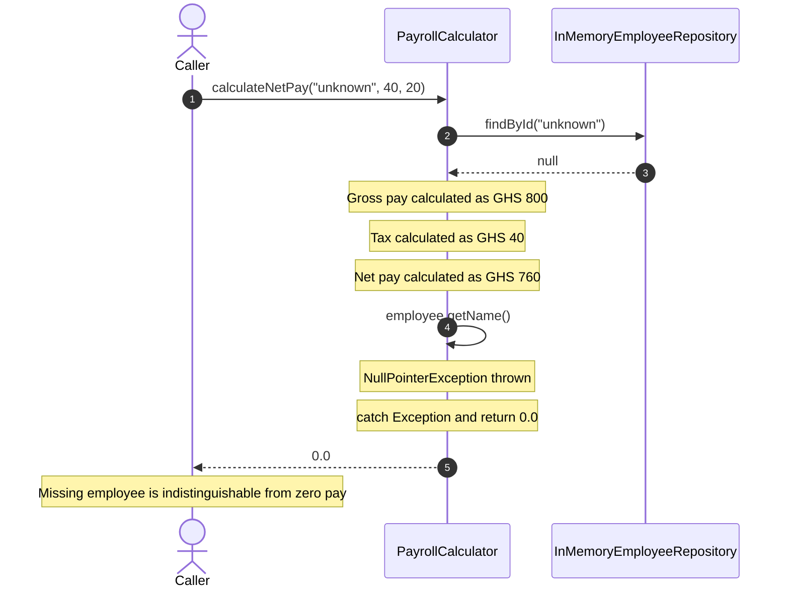
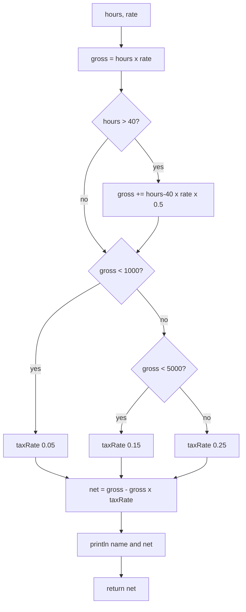
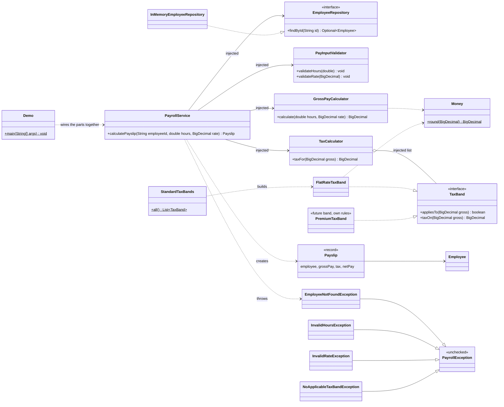
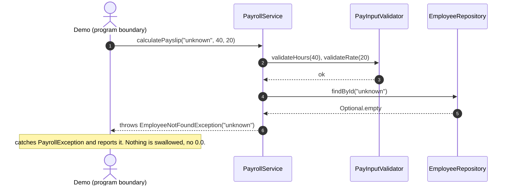

# ANALYSIS: Rosewood Payroll (pre-refactor)

---

## 1. Scope and method

**Inherited code (6 production files, 1 test file):**

| File | Role |
|---|---|
| `PayrollCalculator` | Net-pay calculation (holds almost all the logic) |
| `EmployeeRepository` | Interface for employee lookup |
| `InMemoryEmployeeRepository` | HashMap-backed implementation, returns `null` when not found |
| `Employee` | Simple model (id, name) |
| `Demo` | `main` that exercises the calculator |
| `PayrollCalculatorTest` | 3 AI-generated tests |

**Method:**
1. Ran `mvn verify` (tests and JaCoCo) and the PIT mutation run on the pre-refactor code , and ran the pre-refactor Demo.
2. Used PIT's survivors and no-coverage mutants as evidence of which behaviour the tests do not check.
3. Planted the constant-change bugs by hand. Section 2.3 is the pre-refactor plan; section 9.5 has the results for the refactored code.

**Verification status.** The sandbox used for this revision cannot reach Maven Central, and JaCoCo, PIT, JUnit and Mockito are not cached, so the Maven build and PIT could not be re-run here. What was checked: the main code compiles with `javac` and the Demo runs; the test sources compile against stand-in JUnit and Mockito APIs; 99 test cases were run with a stand-in reflection runner and all passed (the 27 `PayrollServiceTest` cases need real Mockito and were not run); and seven planted bugs were each caught by the tests (section 9.5). The PIT and coverage figures are carried forward from the earlier run recorded in `target/pit-reports`. **Before submission, run `mvn verify` and the PIT command on a machine with Maven access.**
4. Read every file against the coding standard and the SOLID principles.

---

## 2. Baseline evidence

Run on the pre-refactor code: `mvn verify` (tests + JaCoCo), then `mvn test-compile org.pitest:pitest-maven:mutationCoverage`.

| Check | Result |
|---|---|
| `mvn verify` | BUILD SUCCESS. 3 tests run, 0 failures, 0 errors, 0 skipped |
| Console output during tests | `Net pay for Efua Sarpong: GHS 831.25` and `GHS 760.0`. Business data (a name and a pay figure) is printed by the calculator on every call. |
| Hand check of the two real calls | e1, 40h @ 20: gross 800, 5% tax, net **760.0** (matches). e1, 35h @ 25: gross 875, 5% tax, net **831.25** (matches). The LOW band is computed correctly. |
| Both real tests use | the same employee (`e1`), LOW band only, no overtime |
| Demo output for unknown employee | Pre-refactor Demo, measured on commit `ce74af2`: `Result unknown employee -> 0.0`. Refactored Demo: `Could not calculate pay for 'unknown': Employee not found: unknown` |
| JaCoCo line / branch coverage | Not re-measured. The earlier report is not in the upload; read `target/site/jacoco/index.html` after `mvn verify`. |
| PIT line coverage (mutated classes) | **21 / 34 (62%)** |
| PIT mutations generated | **21** |
| PIT killed | **3 (14%)** |
| PIT survived | **8** |
| PIT no coverage | **10** |
| PIT test strength | **27%** (3 killed out of the 11 mutants the tests actually reached) |

**Headline:** 62% of lines are executed and 100% of tests pass, yet only 14% of the injected bugs are caught. Line coverage and a green build say almost nothing about whether the tests would catch a wrong payslip.

### 2.1 PIT results by mutator

| Mutator | Generated | Killed | Survived | No coverage |
|---|---|---|---|---|
| Conditionals boundary (`>` to `>=`, `<` to `<=`) | 3 | 0 | 2 | 1 |
| Negate conditionals | 3 | 0 | 2 | 1 |
| Math (`+ - * /` swapped) | 7 | 1 | 2 | 4 |
| Void method call (statement removed) | 4 | 0 | 1 | 3 |
| Empty object returns | 2 | 0 | 1 | 1 |
| Primitive returns | 1 | 1 | 0 | 0 |
| Null returns | 1 | 1 | 0 | 0 |
| **Total** | **21** | **3** | **8** | **10** |

### 2.2 Reading the PIT results (by inspection; confirm in `target/pit-reports/index.html`)

| Result | Most likely explanation |
|---|---|
| 4 Math mutants: no coverage | The four operators in the overtime line never execute, because no test uses more than 40 hours. |
| 1 conditional boundary and 1 negate: no coverage | `gross < 5000` is never reached, since both real tests stay in the LOW band. MEDIUM and HIGH are untested. |
| Boundary mutants on `hoursWorked > 40` and `gross < 1000` survive | Test inputs are 35h and 40h, with gross 800 and 875. Nothing sits on or near a boundary, so `>=` and `<=` go unnoticed. |
| Math survivors: `hours * rate` and the `-` in `gross - tax` | `net > 0` still holds when gross becomes tiny or tax is added instead of subtracted. |
| The one Math mutant killed | Most likely `gross * taxRate` becoming `/`, which drives net negative and fails `net > 0`. It is caught only by accident. |
| Void method call survived (1) and 3 not covered | Removing the calculator's `println` changes nothing any test checks. The other three are `Demo`'s prints, which no test runs. |
| Empty-object returns: 1 survived, 1 no coverage | `getName()` returning `""` goes unnoticed (it is only printed). `getId()` is never called. |
| Null-return on `findById` killed | Only because a null employee throws an NPE, the catch returns `0`, and `net > 0` then fails. A swallowed exception is the only thing "catching" this mutant. |
| Nothing is reported for `return 0` in the catch | The swallowed failure is invisible to mutation testing, because the mutated value is the same as the original. It needs a deliberate test. |

### 2.3 Planted-bug check: PIT prediction and manual confirmation

PIT already covers boundary changes and removed calls. Constant changes (`0.15` to `0.16`) are not in PIT's default mutators, so those are checked by hand. For each row: change one thing, run `mvn test`, then `git checkout src/`.

| Change | PIT / reasoning predicts | Confirmed manually? |
|---|---|---|
| `0.15` to `0.16` (MEDIUM rate) | Tests stay green: MEDIUM never reached | Not run |
| `hoursWorked > 40` to `>= 40` | Tests stay green: conditional boundary mutant survived | Not run |
| `0.5` to `0.4` (overtime premium) | Tests stay green: overtime block never executes | Not run |
| `gross < 1000` to `gross <= 1000` | Tests stay green: conditional boundary mutant survived | Not run |
| Delete the overtime block entirely | Tests stay green: no coverage | Not run |

### 2.4 Environment note (not a finding about the code)

`mvn verify` printed many `IllegalClassFormatException ... Unsupported class file major version 71 / 68` traces from JaCoCo. These come from JDK-internal and ByteBuddy classes, not from project classes, and the build still succeeded. The cause is a JDK newer than JaCoCo 0.8.12 supports; the starter README asks for JDK 21. Mockito also warns that it is self-attaching its agent. Both are noise for now.

---

## 3. Structure of the inherited code (UML)

### 3.1 Class diagram (as-is)

**What the diagram shows:**
- The `EmployeeRepository` interface exists, but the dashed "HARD-WIRED" arrow bypasses it. The abstraction is never a real seam.
- `PayrollCalculator` is the only class with logic, and it depends on everything else. There is no tax, overtime, validation or money abstraction at all.
- `Employee` is used only to print a name, so the lookup contributes nothing to the number returned.

### 3.2 Sequence diagram: Unknown employee — the silent failure

**What the diagram shows:** The calculator does not check whether the employee exists. It calculates the payslip figures before accidentally triggering a `NullPointerException` when accessing the employee's name. The broad exception handler swallows the error and returns `0.0`, leaving the caller unaware that payroll calculation failed.

### 3.3 Decision flow of the tax calculation (as-is)

**What the diagram shows:** a hard-coded `if/else` ladder. A new band means editing this method, which is an Open/Closed violation.

---

## 4. Code smells and SOLID violations (ranked)

Ranking criterion: **consequence for a real payslip**, then how hard the problem is to notice.

| Rank | Finding | Where | Evidence | Why it matters for payroll | Standard |
|---|---|---|---|---|---|
| **1** | **Swallowed failure.** `catch (Exception e) { return 0; }` | `PayrollCalculator`, catch block | Demo prints `0.0` for an unknown employee | Every error (missing employee, bad input, a bug) becomes `0`, which is also a legitimate answer for 0 hours. Callers cannot distinguish failure from a real result. | Error handling |
| **2** | **No deliberate "not found" handling.** The repository returns `null`; the code never checks it. | `InMemoryEmployeeRepository.findById`; `println` in the calculator | Sequence diagram 3.2 | The missing-employee path only works by accident (an NPE). Remove the print and an unknown employee gets paid. | Error handling |
| **3** | **Money as `double`, no rounding rule** | `PayrollCalculator` throughout | `gross - gross * taxRate` | Binary floating point cannot represent most decimal amounts exactly, and there is no defined rounding to pesewas. Payslips can drift by a fraction of a pesewa. | Objects and data structures |
| **4** | **No input validation** | `calculateNetPay` | -5h @ 20 gives gross -100, tax 5%, **net -95**. `NaN` hours skip every comparison and land in the HIGH band, returning `NaN`. | Negative hours, negative rates, `NaN` and `Infinity` produce nonsense with no error. | Error handling |
| **5** | **Tax bands as an `if/else` chain (Open/Closed)** | `PayrollCalculator` | Diagram 3.3 | The coming tax band cannot be added without editing existing logic, which risks breaking the three bands that already work. | SOLID: Open/Closed |
| **6** | **Hard-wired dependency (Dependency Inversion)** | `new InMemoryEmployeeRepository()` in the field initialiser | Diagram 3.1 | Cannot substitute a stub or mock, so a failing lookup can't be tested. This is the root cause of test 2 being a mock of the class under test. | SOLID: Dependency Inversion; 2.2 composition over inheritance |
| **7** | **God method (Single Responsibility).** One method does lookup, overtime, gross, band selection, tax, net, printing and error policy. | `calculateNetPay` | ~8 reasons to change | Any rule change touches the same method, and nothing can be tested in isolation. | SOLID: Single Responsibility; Functions |
| **8** | **I/O in business logic.** `System.out.println` with the employee's name, pay and a hard-coded `GHS`. | `calculateNetPay` | | Side effect inside a calculation, personal data written to stdout, no logging control, currency hard-coded. | Functions |
| **9** | **Magic numbers.** `40`, `0.5`, `1000`, `5000`, `0.05`, `0.15`, `0.25` | `calculateNetPay` | | Business rules are invisible and unnamed. The comments `// LOW` etc. are standing in for names. | Names |
| **10** | **Pointless employee lookup.** The `Employee` is used only for the print, while the rate comes from the caller. | `calculateNetPay` | | Either the lookup should be a real validation (employee must exist), or it should be removed. This needs a design decision (see Decisions). | 2.2 YAGNI |
| **11** | **Primitive obsession / unclear API.** Three loose primitives (`String`, `double`, `double`) in a fixed order. | Method signature | | Easy to swap `hours` and `rate` without the compiler noticing. No types for money or hours. | Objects and data structures |
| **12** | **Repository returns `null` instead of `Optional`/exception.** | `EmployeeRepository` contract | | The contract does not tell callers that absence is possible. | Error handling |
| **13** | **`Demo` coupled to the concrete constructor** | `Demo` | | Will break when dependencies are injected, so it must be updated as part of the refactor. | SOLID: Dependency Inversion |

### 4.1 SOLID scorecard

| Principle | Violated? | Where |
|---|---|---|
| **S**ingle Responsibility | Yes | Findings 7, 8 |
| **O**pen/Closed | Yes | Finding 5 |
| **L**iskov Substitution | Not evidenced | Only one implementation exists to compare |
| **I**nterface Segregation | Not evidenced | `EmployeeRepository` is small and focused |
| **D**ependency Inversion | Yes | Finding 6 |

---

## 5. Open business question: cliff-edge tax

The tax rate applies to the **entire** gross, not just the slice above each threshold.

| Gross | Rate | Tax | Net |
|---|---|---|---|
| 999.99 | 5% | 50.00 | **949.99** |
| 1000.00 | 15% | 150.00 | **850.00** |
| 4999.99 | 15% | 750.00 | **4249.99** |
| 5000.00 | 25% | 1250.00 | **3750.00** |

Earning GHS 0.01 more **reduces** take-home pay by about GHS 100 at the first threshold and about GHS 500 at the second. Real tax systems apply marginal bands.

**Status:** unresolved. I cannot tell from the code whether this is the business rule or an AI-introduced bug. I will **not** silently change it during the refactor. The decision and its reasoning go in the Decisions section. Either way, both boundaries need explicit boundary tests.

---

## 6. AI-generated tests that prove nothing (ranked separately)

Measured against the standard's test-driven development chapter: a test that cannot fail, or that checks a mock instead of behaviour, protects nothing.

| Rank | Test | What it really asserts | Why it cannot catch a bug | Verdict |
|---|---|---|---|---|
| **1** | `calculatesOvertimePay` | A `mock(PayrollCalculator.class)` returns the value it was told to return (1402.5) | **The real code never runs.** It tests Mockito. It would pass if the whole calculator were deleted. The name falsely claims overtime coverage. | Hollow: worst |
| **2** | `returnsPayForAnEmployee` | `assertNotNull(net)` where `net` is a primitive `double` | A primitive is autoboxed, so it can never be `null`. **The assertion cannot fail.** | Hollow |
| **3** | `calculatesNetPay` | `net > 0` for e1, 40h @ 20 | Runs the real code, but accepts any positive number. Wrong rate, wrong tax, wrong gross all pass. Correct value is 760. | Weak |

**Rank reasoning:** test 1 is the most dangerous because it looks like overtime coverage while exercising none of the code, and it inflates confidence for the most error-prone rule. Test 2 is a logical impossibility. Test 3 at least touches real code and would fail if the lookup broke.

**What was good and is kept:** the figure `1402.5` in test 1 is correct (50h @ 30 gives gross 1650, 15% tax). The expectation is reused, but in a real test against the real code.

### 6.1 Coverage map: what the 3 tests actually exercise

| Behaviour | Exercised by any test? |
|---|---|
| Employee found | Yes (tests 1, 3) |
| Employee not found | No |
| Overtime branch (`hours > 40`) | No |
| Exactly 40 hours | Yes, but no overtime assertion |
| LOW band (< 1000) | Yes, but value unchecked |
| MEDIUM band (1000 to 4999.99) | No |
| HIGH band (>= 5000) | No |
| Invalid hours or rate | No |
| Catch block | No |
| Exact net value | **No** |

---

## 7. Missing tests (written during the rebuild)

- Unknown employee raises a specific exception (not `0`).
- Zero hours, negative hours, `NaN`, `Infinity` rejected.
- Exactly 40 h (no overtime), 40.5 h, 41 h (premium on the extra hours only).
- Band boundaries: 999.99, 1000.00, 4999.99, 5000.00.
- Exact expected values computed by hand (not copied from code output).
- Rounding behaviour to two decimal places.
- Repository collaborator failing (using a stub or mock through the injected seam).

---

## 8. Most serious problem

The most serious problem is the **swallowed failure combined with hollow tests**. Individually they are bad, but together they make every other defect invisible: the code converts any error into a plausible-looking `0`, and the test suite cannot detect either the wrong number or the wrong behaviour. Money as `double` and the cliff-edge tax are real risks, but they would be caught by a suite that asserted exact values. The swallowed exception and the green-but-empty tests are what stop anyone from finding them. The measured evidence fits this: the build is green with 62% line coverage, yet PIT kills only 3 of 21 mutants (14%), and the one test that kills anything does so by accident through `net > 0`.

*(Be ready to argue the opposite: why might `double` for money, or the missing validation, be worse?)*

---

## 9. Decisions (written after the refactor)

### 9.1 Result in one table

| | Inherited code and tests | After the refactor |
|---|---|---|
| Production classes with logic | 1 (`PayrollCalculator`, one method doing 8 jobs) | `PayrollService` (orchestration only), `PayInputValidator`, `GrossPayCalculator`, `TaxCalculator`, `TaxBand` / `FlatRateTaxBand` / `StandardTaxBands`, `Money`, `Payslip` |
| Tests | 3 (2 hollow, 1 weak) | 126 test cases, all asserting exact figures or exact exceptions. 99 were run here with a stand-in runner; the 27 in `PayrollServiceTest` need Mockito and were not run |
| PIT mutants killed | 3 of 21 (14%) | **52 of 52 (100%)** |
| PIT mutants not covered | 10 | **0** |
| PIT test strength | 27% | **100%** |
| PIT line coverage (mutated classes) | 62% | **96%** (105 of 109) |
| Unknown employee | returns `0.0` | throws `EmployeeNotFoundException` |
| Negative hours | returns negative pay | throws `InvalidHoursException` |
| Money | `double`, no rounding rule | `BigDecimal`, 2 decimals, half-up |
| New tax band | edit the `if/else` chain | add a `TaxBand` (one class or one config entry) |

The "after" PIT run used `DEFAULTS` plus `EXPERIMENTAL_BIG_DECIMAL`, because the default mutators do not touch `BigDecimal` method calls and the first run after the refactor therefore skipped the money arithmetic (it listed no Math mutants at all). `Demo` is excluded from mutation testing (D15). The two runs use different mutator sets, so they show the shape of the improvement, not a like-for-like score. Both "after" figures come from the PIT report in the upload, which predates the changes in section 9.10.

### 9.2 Design after the refactor (UML)

**Package layout (hexagonal):** `domain` (model, exception, pay, tax) depends on nothing; `port` holds the repository interface; `adapter.persistence` implements it; `application` coordinates; `validation` checks inputs; `Demo` is the composition root. Dependencies point inward only.

**The same scenario that used to return 0.0 (unknown employee):**

### 9.3 Key decisions and why

| # | Decision | Why | How I checked it |
|---|---|---|---|
| D1 | The repository returns `Optional<Employee>`; `PayrollService` turns "absent" into `EmployeeNotFoundException`. | Absence is a normal answer for a lookup, but for payroll it is an error. The old code only noticed by accident (a `NullPointerException` inside a `catch`). | `PayrollServiceTest.anUnknownEmployeeIsAnErrorNotAZeroPayslip`, `PayrollServiceIntegrationTest.anUnknownEmployeeNowFailsInsteadOfReturningZero`, `InMemoryEmployeeRepositoryTest` |
| D2 | Hours: reject negative, `NaN`, infinite, and above 168. Rate: reject null, negative and above GHS 10,000. Employee id: reject blank. **Zero is valid for both.** Hours stay `double`; the rate became `BigDecimal`. | A valid zero must be distinguishable from a failure. A rate is money, so it must not be a binary float. | `PayInputValidatorTest` (boundary cases 0 and -0.01), `PayrollServiceTest` (`verifyNoInteractions` plus the exception type) |
| D3 | Money is `BigDecimal`, scale 2, `HALF_UP`, defined once in `Money`. | Removes floating-point drift and gives the rounding rule one home. | `MoneyTest` (tie cases `0.005` to `0.01`, `49.9995` to `50.00`); PIT `BigDecimalMutator`: 8 of 8 killed |
| D4 | **Preserve** the current tax behaviour: the rate applies to the whole gross, so 999.99 nets 949.99 but 1000.00 nets 850.00. | Changing a business rule silently inside a refactor is riskier than leaving it. It is recorded as an open question (section 5). | Boundary rows G6 to G9 in `TaxCalculatorTest` and `PayrollServiceTest` pin the current behaviour. |
| D5 | The result is a `Payslip` record (employee, gross, tax, net), not a single number. | Tests can assert every component, and callers see how the net figure was reached. | `PayslipTest`, golden-table assertions on all four fields |
| D6 | One unchecked `PayrollException` base with specific subtypes. | One catch point for callers that can recover, clear types where they add meaning, and no forced `throws` noise. | `NoApplicableTaxBandExceptionTest`, `PayInputValidatorTest` |
| D7 | The `println` was removed. | I/O and personal data inside business logic. The Demo prints at the boundary instead. | Demo output reviewed; no test output contains names or pay |
| D8 | Gross is rounded to 2 decimals at the end of the gross calculation. | A payslip amount is money, so it has pesewas. | `GrossPayCalculatorTest` (`41h at 10.01` gives 415.42 from 415.415) |
| D9 | One `TaxBand` interface and one configurable `FlatRateTaxBand`, not three copy-pasted Low/Medium/High classes. | A new band is one new entry, or one new class if its rule is different, so nothing existing is edited. | `NewTaxBandExtensionTest` |
| D10 | The first matching band wins, and no match throws `NoApplicableTaxBandException` instead of taxing at zero. | A gap in the configuration must fail loudly. | `TaxCalculatorTest.firstMatchingBandWins`, `failsLoudlyWhenNoBandCoversTheAmount` |
| D11 | The payslip carries the employee, so the lookup has a purpose. | In the old code the employee was only used for a `println`. | `PayrollServiceTest` (`assertSame(efua, payslip.employee())`) |
| D12 | Validate inputs before looking the employee up. | Bad input should never cause a lookup. | `invalidHoursAreRejectedBeforeAnyLookup` (`verifyNoInteractions` beside the exception assertion) |
| D13 | `PayrollService` never catches. `Demo` catches `PayrollException` at the program boundary. | Catch only where someone can be told. Nothing is swallowed or hidden. | `aRepositoryFailureReachesTheCallerUntouched` (`assertSame`), `aGapInTheTaxBandsReachesTheCaller...` |
| D14 | Only `EmployeeRepository` is an interface. | It is the real I/O boundary. The calculators are plain classes used for real in tests, which keeps mocks to the one seam that needs one. | Mockito is used only for the repository; every other collaborator in `PayrollServiceTest` is real. |
| D15 | PIT runs with `EXPERIMENTAL_BIG_DECIMAL`, and `Demo` is excluded. | The default mutators skip `BigDecimal` calls; `Demo` is pure wiring and printing with no logic to protect. | PIT before and after tables in 9.1 |
| D16 | Hexagonal package layout (`domain`, `port`, `adapter`, `application`, `validation`). | Dependencies point inward and the repository can be swapped without touching the rules. | Package structure and imports |

**Assumptions not confirmed with the business:** a rate of 0 is allowed; there is no upper limit on hours; the tax cliff at 1000 and 5000 is kept; rounding is half-up to 2 decimals.

### 9.4 How the design absorbs the coming tax band

The business is about to add a new tax band with its own rules. In the inherited code that meant editing the `if/else` ladder inside the one method that also did everything else, and risking the three bands that already worked.

Now the bands are data handed to `TaxCalculator`, which depends only on the `TaxBand` interface.

- **A band that is just another flat rate:** add one row to the tier table in `StandardTaxBands`. The previous top tier gets its upper bound from the new row, so no existing band is edited by hand.
- **A band with different rules:** write one new class that implements `TaxBand`. `NewTaxBandExtensionTest` does exactly this with a `PremiumTaxBand` (5,000 plus 35% of the amount above 20,000). **No production class is edited.** The old results are unchanged (1402.50 and 3750.00 still hold) and the new band is checked at 20,000.00, 28,000.00 and 19,999.60.
- **The usual mistake is guarded:** `TaxBandCoverageTest` checks every amount from 0.00 to 20,000.00 on a GHS 1.00 grid, plus one pesewa either side of each band boundary, and fails if any amount is covered by no band (a gap) or by two bands (an overlap). Because bands are ranges, a gap or an overlap can only start at a boundary, so this finds them without checking all 2 million pesewas. Two extra tests feed it a deliberately wrong list, so the guard itself is proven.

### 9.5 What I kept, fixed or rewrote from the AI, and how I checked it

| Item | Verdict | What and why | How I checked |
|---|---|---|---|
| Tax rates, thresholds and overtime rule (5/15/25%, 1000/5000, 40h at 1.5x) | **Kept** | They are the business rules. I changed where they live, not what they say. | Hand-computed golden table, 11 rows, checked against the old code with `jshell` before refactoring |
| `Employee` model | **Kept** | Small and fine. | Used by `Payslip` and the tests |
| `EmployeeRepository` | **Fixed** | Same purpose, but the contract now says absence is possible (`Optional`). | `InMemoryEmployeeRepositoryTest` |
| `InMemoryEmployeeRepository` | **Fixed** | Returns `Optional`, and gained a constructor that takes a list so tests control the data. | `InMemoryEmployeeRepositoryTest` |
| `PayrollCalculator` | **Rewrote** | One method doing eight jobs, with a swallowed failure, `double` money and a hard-wired dependency. Replaced by `PayrollService`, `PayInputValidator`, `GrossPayCalculator`, `TaxCalculator` and `TaxBand`. | Findings 1 to 13 in section 4, traced in 9.6 |
| `Demo` | **Rewrote** | Same purpose, but it is now the composition root and the only place a failure is caught and reported. | Run output shows the four expected lines |
| `calculatesOvertimePay` | **Rewrote** | It mocked the class under test and could never fail. The figure it used (1402.5) was right, so the expectation was kept and tested against real code. | `PayrollServiceTest` golden row G5; `PayrollServiceIntegrationTest.paysKwameOvertimeInTheMediumBand` |
| `returnsPayForAnEmployee` | **Deleted** | `assertNotNull` on a primitive `double` cannot fail. | n/a |
| `calculatesNetPay` | **Rewrote** | `net > 0` accepts any positive number. Replaced by exact-value assertions. | `PayrollServiceIntegrationTest.paysEfuaInTheLowBand` (760.00) |

**Verification that the new tests catch bugs:**
- **PIT:** 52 of 52 mutants killed, 0 not covered (with the `BigDecimal` mutator, `Demo` excluded).
- **Planted bugs, re-run.** PIT does not mutate constants, so these were planted by hand in a throwaway copy. Each change made at least one test fail: `1.5` to `1.25` in `GrossPayCalculator` (7 failures); `40` to `41` hours in `GrossPayCalculator` (7); `0.15` to `0.16` in `StandardTaxBands` (5); `HALF_UP` to `HALF_EVEN` in `Money` (2); the `168` hours limit moved to `170` (1); `>=` to `>` on a band's lower bound (11); and net pay computed as gross plus tax (9). These counts come from a stand-in runner, not JUnit, so re-run them with Maven to confirm.

### 9.6 Every finding, and where it was resolved

| Finding (section 4 rank) | Resolved by |
|---|---|
| 1 Swallowed failure | No `catch` in `PayrollService`; `aRepositoryFailureReachesTheCallerUntouched`; `Demo` catches only at the boundary |
| 2 No deliberate "not found" | `Optional` plus `EmployeeNotFoundException` (D1) |
| 3 Money as `double` | `BigDecimal` and `Money` (D3) |
| 4 No input validation | `PayInputValidator` (D2) |
| 5 Tax `if/else` (Open/Closed) | `TaxBand` strategy (D9), proven by `NewTaxBandExtensionTest` |
| 6 Hard-wired dependency | Constructor injection throughout; composition root in `Demo` |
| 7 God method | Five collaborators with one job each |
| 8 I/O in business logic | `println` removed (D7) |
| 9 Magic numbers | Named constants in `GrossPayCalculator`, rates and bounds in `StandardTaxBands` |
| 10 Pointless lookup | The payslip carries the employee (D11) |
| 11 Primitive obsession | **Partly:** the rate is `BigDecimal` and the result is a `Payslip`, but `hoursWorked` is still a `double` and the employee id a `String`. |
| 12 Repository returns `null` | `Optional` (D1) |
| 13 `Demo` coupled to the constructor | `Demo` is the composition root |

### 9.7 One improvement beyond the brief: the tax band coverage sweep

`TaxBandCoverageTest` guards against a whole class of bug: a gap or overlap in the tax bands. It matters because the business is about to add a band, and the cheapest wrong boundary produces payslips that are wrong only for certain amounts, which a handful of example tests would not notice. It checks boundaries rather than every pesewa, so it stays fast, and it keeps guarding every future edit to `StandardTaxBands`.

### 9.8 Open questions for the business

1. Is the whole-gross tax rate intended? Earning 0.01 more at a threshold lowers take-home pay by about 100 at 1000 and about 500 at 5000.
2. Is a rate of 0 valid, and should hours have an upper limit?
3. Is half-up to 2 decimals the required rounding rule?
4. Are an hours limit of 168 per pay period and a rate limit of GHS 10,000 acceptable? Both are sanity bounds I chose; the length of a pay period is not in the brief.

### 9.9 Alignment with the standard's general principles (2.2)

| Principle | Evidence in this code |
|---|---|
| KISS | `PayrollService.calculatePayslip` reads as five plain steps: validate, look up, gross, tax, net. No framework, no reflection. |
| DRY | One `FlatRateTaxBand` instead of three copy-pasted band classes (D9); one `Money` class for the rounding rule (D3); the golden table is the single source for expected figures. |
| YAGNI | Only the repository is an interface (D14); no speculative plugin or rules engine. The new band is supported by the seam that exists, not by extra machinery. |
| Composition over inheritance | `PayrollService` holds four collaborators instead of extending anything. Inheritance appears only for the exception types, where it is the language's own mechanism. |
| Readability | Named constants (`STANDARD_HOURS`, `OVERTIME_MULTIPLIER`, band rates), intention-revealing method names, tests named as sentences. |
| Consistency | All money is `BigDecimal` rounded by `Money`; every deliberate failure is a `PayrollException` subtype. **One departure, on purpose:** constructors of `FlatRateTaxBand`, `TaxCalculator` and `InMemoryEmployeeRepository` throw `IllegalArgumentException` or `NullPointerException` for wrong *configuration*. That is a programmer error, not a payroll failure. |

## 9.10 Changes in this revision

| Finding from the hygiene check | What changed | Status |
|---|---|---|
| Unused `ObjectName` import; spacing in `Payslip` and the exceptions package | Import removed; braces and spacing made consistent across `src/` | Done |
| Demo seed data inside the production repository adapter | `InMemoryEmployeeRepository` holds only what it is given. `Demo` has its own sample staff. Tests use `SampleStaff` | Done |
| `hoursWorked` is a `double` converted with `BigDecimal.valueOf` | Kept as `double` for the API. The conversion is documented (it uses the shortest decimal form, so 40.1 stays 40.1), and hours are bounded to 0 to 168. Changing the type would ripple through the public API | Partly, by choice |
| `findById(null)` silently returns empty | Now a `NullPointerException`: a null id is a caller bug | Done |
| `employeeId` never validated | `InvalidEmployeeIdException` for null or blank ids | Done |
| No upper sanity bound on rate | Rate capped at GHS 10,000 and hours at 168 (assumptions; see 9.8, question 4) | Done, to confirm |
| Open-ended top band: a new band invites a gap or overlap | Bands are built from a tier table. Each upper bound comes from the next row, and `FlatRateTaxBand` rejects an empty range | Done |
| Tax thresholds and rates are magic constants | Bands are rows in one table. Not moved to an external config file: a file would add a loader and a failure mode for a rule that changes rarely | Partly, by choice |
| Overtime constants may vary by contract | Kept as named constants | Not changed |
| Net pay subtracted inline in the service | `Payslip.of` derives net pay, so the three figures cannot disagree | Done |
| No logging at the service boundary | `PayrollService` logs unknown employee ids at WARNING through `java.util.logging`, which is part of the JDK, so no new dependency. It logs ids only, never names or pay | Done |
| Coverage sweep runs 2 million iterations | Boundary probes plus a GHS 1.00 grid, in `TaxBandAssertions` | Done |
| `NewTaxBandExtensionTest` depends on `TaxBandCoverageTest`'s helper | The helper is now `TaxBandAssertions`, a shared test utility | Done |
| `verifyNoInteractions` is the only check in some tests | Each rejection test asserts the exception and its value first. `verifyNoInteractions` stays as the secondary check | Done |
| Trailing blank lines, stray blank line in `FlatRateTaxBandTest` | Removed | Done |
| Duplicated comment in `pom.xml` | Removed | Done |
| `README.md` describes the starter brief | Rewritten for the delivered design, assumptions and test commands | Done |
| Placeholders: the test count, the 2.3 "confirmed manually" cells, `§` references, a DRAFT tag, a duplicate heading in 3.2 | Count filled in; duplicate heading and DRAFT tag removed; `§` references removed because the standard is not in the upload; 2.3 cells now read "Not run" | Partly: the 2.3 checks were not run on the pre-refactor code |
| Commit history: `fix: update analysis`, `fix: analysis.md update`, merge commit with no body | Not changed. Rewriting shared history needs your decision | Open |